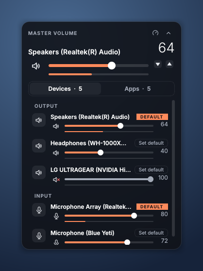
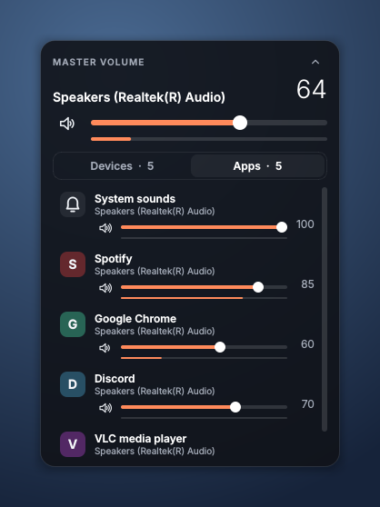
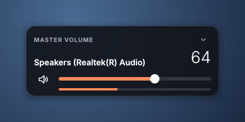
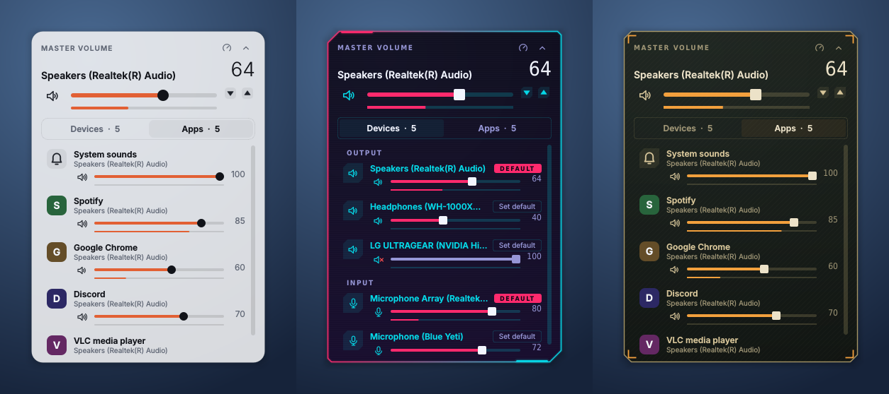
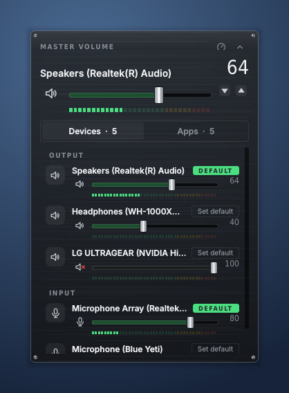
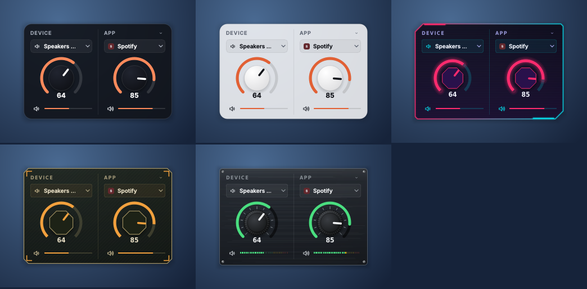
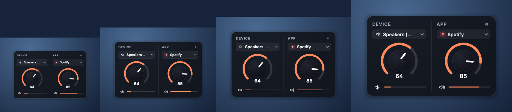

# Volume Mixer Widget

A desktop widget for Windows 10 and 11 that puts your volume controls on the
screen. The master volume is always at the top; underneath, one tab controls
every audio device and the other controls every app separately.

It's the sister of my [World Clock Widget](https://github.com/nihalkaler/world-clock-widget):
same themes, same placements, same right-click menu, so the two look like a set.

| Devices | Apps |
| --- | --- |
|  |  |

- **Master volume, always on show**: slider, mute and a live level meter for
  the default output. It follows Windows when you switch speakers.
- **Devices tab**: every output (speakers, headphones, HDMI) and input
  (microphones), each with its own volume, mute and level meter.
  **Set default** makes any of them the Windows default.
- **Apps tab**: every app using sound, each with its own volume and mute, like
  the Windows volume mixer. Apps come and go as they start and stop playing.
- **Master volume only**: click the arrow (or use the menu) to shrink the
  widget down to just the master volume.

  

- **Stays in a fixed spot**: drag it where you want, then lock it. It can sit
  on the desktop behind your windows, act like a normal window, or stay
  always on top
- **Runs all the time**: starts with Windows, sits in the tray, and has no
  taskbar button
- **Two modes**: **Default** (the full mixer) and **Dials**, where you pick a
  device from one dropdown and an app from the other and turn each with its
  own knob
- **Dark, Light, Cyberpunk, Tactical and Sound board themes**, sizes for each
  mode, and your own accent colour



**Sound board** looks like a mixing desk: a brushed-metal panel with a screw
in each corner, metal fader caps, and LED meters that go green, yellow, red.



## Dials mode

Right-click → **Mode** → **Dials** (or click the little knob icon next to
**Master volume**) turns the widget into two knobs:



- **Device** (left): pick a speaker, headphones or microphone from the
  dropdown. **Default output** follows whichever device Windows is using, so
  out of the box this dial is the master volume.
- **App** (right): pick any app that's playing sound. If that app closes, the
  dial shows another one meanwhile and switches back when your app starts
  playing again.
- **Click anywhere on a dial's scale** and it jumps straight to that volume;
  a faint dot shows where it will land before you click. **Drag round the
  dial** and it follows the mouse (it stops at 0% and 100% rather than
  jumping across the gap at the bottom).
- **The arrows** either side of each dial turn it down or up 1% a click, and
  keep going while you hold them.
- For fine control you can also **scroll** over a dial (2% a notch, 1% with Shift) or
  **hold Shift and drag** up or down.
- The speaker icon under each knob mutes it, and the bar shows how loud it is
  right now.
- The faders icon top-right, or right-click → **Mode** → **Default**, brings
  back the full mixer.

Your picks are remembered, also across restarts.

**Sizes.** Each mode has its own sizes and remembers its own choice, so a
Large mixer and Small dials stay that way when you switch back and forth.
Dials come in Extra small, Small, Normal, Large and Extra large:



## Getting it

**Download:** grab `VolumeMixer.exe` from the [Releases](../../releases) page,
put it somewhere permanent (for example `C:\Users\<you>\Apps\VolumeMixer\`)
and double-click it. Windows SmartScreen may warn about an unsigned app the
first time; choose **More info → Run anyway**.

On first launch it appears in the bottom-right corner, near the Windows volume
icon, and turns on **Start with Windows**.

## Using it

| To do this | Do this |
| --- | --- |
| Change a volume | Drag a slider, or scroll over it |
| Mute / unmute | Click the speaker (or microphone) icon |
| Move the widget | Drag any empty part of it with the left mouse button |
| Stop accidental dragging | Right-click → **Lock position** |
| Make a device the Windows default | Devices tab → **Set default** |
| Show just the master volume | Click the arrow top-right, or right-click → **Master volume only** |
| Keep it behind windows, normal, or on top | Right-click → **Placement** |
| Switch between the full mixer and the dials | Right-click → **Mode**, or the knob / faders icon top-right |
| Change the size | Right-click → **Size** (sizes for whichever mode is showing) |
| Change the theme | Right-click → **Theme** |
| Set a dial | Click the spot on its scale, or drag round it |
| Nudge a dial up or down | Click (or hold) the arrows beside it |
| Fine-tune a dial | Scroll over it, or Shift-drag up or down |
| Reach the menu when the widget is covered | Click the icon in the system tray |
| Open the Windows sound settings | Right-click → **Windows sound settings…** |

In **On the desktop** placement the widget stays behind your other windows.
When you press Win+D or click the wallpaper, it comes forward so you can see
it. **Bring the widget forward** in the menu does the same at any time.

Clicking the widget never takes the focus away from what you're typing in.

## Settings file

Everything is saved to `%APPDATA%\VolumeMixerWidget\config.toml`.
Right-click → **Edit settings file…** opens it in Notepad, and changes appear
within a second of saving:

```toml
mode = "default"      # default (full mixer) | dials
theme = "dark"        # dark | light | cyberpunk | tactical | soundboard
size = 50             # full mixer: 30 to 100, 50 is normal, 100 is twice as big
dial_size = 50        # dials: 35 to 100, 50 is normal
layer = "desktop"     # desktop | normal | top
locked = false        # true stops the widget being dragged
opacity = 0.85        # background, 0.3 to 1.0
tab = "devices"       # devices | apps
compact = false       # true shows the master volume only
accent = "#2EC4B6"    # optional: your own accent colour

dial_device = "default"   # what the device dial controls; "default" follows Windows
dial_app = "spotify.exe"  # what the app dial controls
```

If the file has a mistake, the widget tells you what's wrong and keeps using
the last good settings.

## Removing it

Right-click → untick **Start with Windows** → **Exit**, then delete the exe
and the `%APPDATA%\VolumeMixerWidget` folder.

## Run from source

Needs Python 3.11 or newer.

```bash
git clone https://github.com/nihalkaler/volume-mixer.git
cd volume-mixer
python -m venv .venv
.venv\Scripts\activate
pip install -r requirements-dev.txt
python run.py
```

`python run.py --demo` uses pretend devices and apps, and works on macOS and
Linux too, which is handy for working on the look. `--settings PATH` uses a
different settings file.

## Build the .exe yourself

```bash
pyinstaller run.py --name VolumeMixer --onefile --windowed --noconfirm ^
  --icon assets/icon.ico --add-data "assets;assets" --paths src ^
  --collect-submodules pycaw
```

The file appears in `dist\VolumeMixer.exe`.

## Releasing a new version

GitHub Actions (`.github/workflows/build.yml`) runs the tests and builds the
.exe on every push. To publish a download, create a release on GitHub with a
new tag such as `v1.2.0`; the workflow attaches `VolumeMixer.exe` to it a
couple of minutes later.

## Tests

```bash
python -m pytest -q tests
```

The tests drive the real widget against the demo audio backend, so they run on
any OS without a sound card. They cover the volume controls, every theme,
sizes, the dials (picking devices and apps, turning knobs, apps closing and
coming back), dragging and locking, compact mode, and the settings file
(including mistakes in it).

## How it works

| File | What it does |
| --- | --- |
| `src/volume_mixer/window.py` | The widget: borderless see-through panel (drawn per theme, with shadow, scanlines, hatching and corner brackets), dragging, the right-click and tray menu, settings changes, and the refresh timers |
| `src/volume_mixer/desktop.py` | Windows integration through `ctypes`: placement layers, bringing the widget forward on Win+D (a foreground-window hook, as in the clock), not stealing focus, and Start with Windows (registry `Run` key) |
| `src/volume_mixer/windows_audio.py` | Windows Core Audio via [pycaw](https://github.com/AndreMiras/pycaw): devices, per-app sessions, level meters, and `IPolicyConfig` for the default device |
| `src/volume_mixer/widgets.py` | Master volume card, volume rows, level meters (bars, or LEDs on the sound board), sliders |
| `src/volume_mixer/dials.py` | Dials mode: knobs drawn per theme (knurled desk knobs on the sound board, faceted ones on the HUD themes), and the device and app dropdowns |
| `src/volume_mixer/theme.py` | The five themes (four share the World Clock Widget's colours) and the size-aware stylesheet, including the sound board's fader caps |
| `src/volume_mixer/config.py` | Settings: TOML load/save, defaults, and keeping values in range |
| `src/volume_mixer/icons.py` | Icons drawn in code in the theme's colours |
| `src/volume_mixer/demo_audio.py` | Pretend audio system for `--demo` and the tests |

The widget polls Windows once a second for device and app changes and 20 times
a second for the level meters, all on the UI thread, so there are no COM
threading issues.

## Licence

MIT, see [LICENSE](LICENSE).
